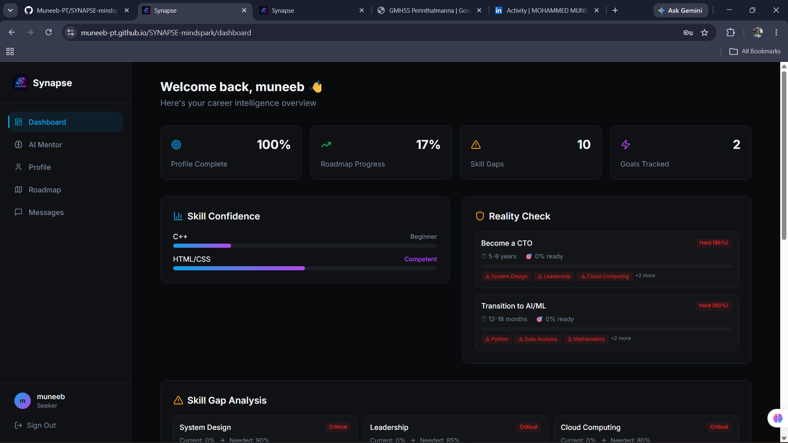
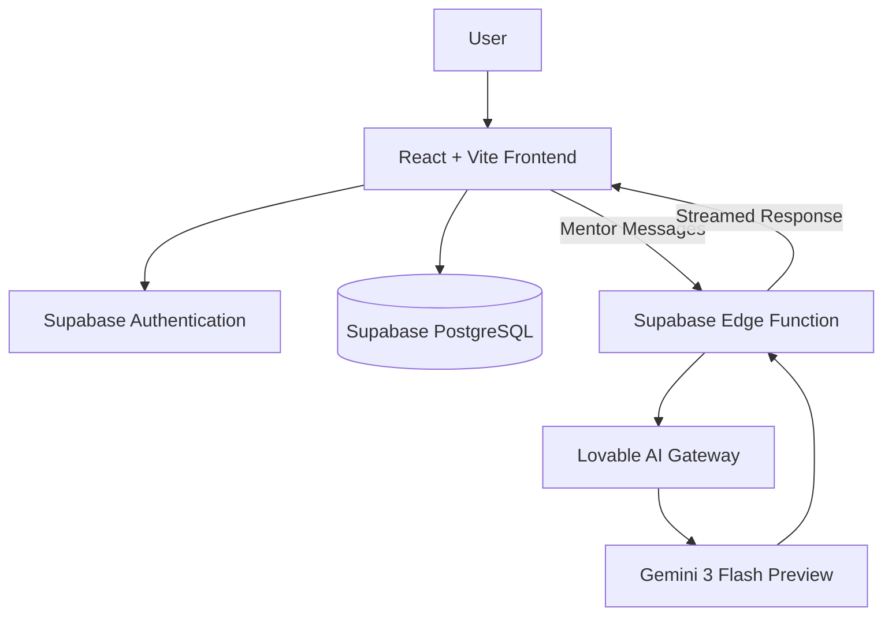

<div align="center">

  

  # SYNAPSE

  ### Your career deserves intelligence — not just a resume.

  **An AI-assisted career intelligence platform exploring a smarter way to understand talent, develop skills, and guide careers.**

  <br />

  [**🚀 Live Demo**](https://muneeb-pt.github.io/SYNAPSE-mindspark/) · [**Source Code**](https://github.com/Muneeb-PT/SYNAPSE-mindspark)

  <br />

  
  
  
  

  <br />

  **Built in 2 hours · KAPRICIOUS'26 · KMEA Engineering College, Cochin**

  *Our first hackathon as first-year engineering students.*

</div>

---

## 01. The Idea

Traditional recruitment often starts with a resume. But a resume cannot always communicate someone's potential, interests, learning progress, or long-term goals.

Students may have the motivation to build a career but lack direction, relevant skills, or access to meaningful guidance. Recruiters, meanwhile, need better ways to understand candidates beyond lists of keywords.

**SYNAPSE explores a more personal approach to career intelligence.**

The concept is built around a living professional profile that brings together:

- Skills and proficiency levels.
- Career interests and long-term goals.
- Education and experience.
- Strengths and areas for improvement.
- Personalized career guidance.

The goal is to move beyond simply asking *"What does this person know?"* and start exploring *"What can this person become?"*

## 02. Product Overview

| Component | Purpose |
|---|---|
| AI Mentor | Conversational career guidance powered by Gemini 3 Flash. |
| Living Profiles | A richer representation of an individual's skills, interests, and goals. |
| Career Roadmaps | Structured career-development experiences. |
| Skill Intelligence | Rule-based skill-gap and readiness calculations. |
| Recruiter Experience | A prototype of candidate discovery beyond traditional resumes. |

*Some components are demonstrations or concept implementations rather than fully connected production features. See Project Status below.*

## 03. Screenshots

<div align="center">

  ### Home Page

  

  <br /><br />

  ### Dashboard

  

  <br /><br />

  ### Login

  

</div>

---

## 04. How It Works

SYNAPSE uses a React frontend, Supabase for authentication and data storage, and a Supabase Edge Function to communicate with the AI service.



### Application Architecture

- **Frontend:** React and TypeScript provide the application interface.
- **Authentication:** Supabase Auth handles email/password authentication.
- **Database:** PostgreSQL stores user profile information and related records.
- **Security:** Row-Level Security policies help restrict access to user data.
- **AI Integration:** The Mentor feature communicates with Gemini 3 Flash Preview through the Lovable AI Gateway.

---

## 05. Technology Stack

| Layer | Technologies |
|---|---|
| Frontend | React 18, TypeScript, Vite |
| UI | Tailwind CSS, shadcn/ui, Radix UI |
| Routing | React Router |
| State & Data | TanStack Query |
| Forms & Validation | React Hook Form, Zod |
| Backend | Supabase |
| Database | PostgreSQL |
| Authentication | Supabase Auth |
| Serverless Functions | Supabase Edge Functions, Deno |
| AI | Lovable AI Gateway, Gemini 3 Flash Preview |
| Testing | Vitest, Testing Library, Playwright dependencies |
| Development | Lovable, ESLint |

---

## 06. Project Status

SYNAPSE was developed during a **two-hour hackathon**. It is an early working prototype, not a finished recruitment platform.

Transparency about implementation is important.

### Implemented

- Email/password authentication through Supabase.
- User profile and related information stored in Supabase.
- Database access protected through Row-Level Security policies.
- AI Mentor integration through a Supabase Edge Function.
- Streaming AI responses through the Lovable AI Gateway.

### Prototype / Incomplete

- Dashboard, Roadmap, and some Recruiter and Profile sections use demonstration data.
- Career-readiness and skill-gap calculations use predefined rules.
- Candidate matching is not yet a complete, production-ready matching engine.
- Some planned recruiter workflows still require backend development.

### Development Priorities

- Connect remaining demonstration screens to live database records.
- Improve career-readiness and skill-gap evaluation.
- Develop a proper candidate-matching system.
- Add persistent AI Mentor conversations.
- Expand recruiter functionality.

---

## 07. Run Locally

### Requirements

- Node.js 18 or later.
- npm.
- A Supabase project.
- Supabase CLI for Edge Function deployment.

### 1. Clone the repository

```bash
git clone https://github.com/Muneeb-PT/SYNAPSE-mindspark.git
cd SYNAPSE-mindspark
```

### 2. Install dependencies

```bash
npm install
```

### 3. Configure environment variables

Create a `.env` file in the project root:

```env
VITE_SUPABASE_URL=your_supabase_project_url
VITE_SUPABASE_PUBLISHABLE_KEY=your_supabase_publishable_key
```

Use the corresponding values from your Supabase project settings.

**Important:** Never commit private API keys or service-role keys to the repository.

### 4. Configure the AI Mentor

Set the Lovable AI Gateway key as a Supabase secret:

```bash
supabase secrets set LOVABLE_API_KEY=your_lovable_gateway_key
```

Deploy the Edge Function:

```bash
supabase functions deploy ai-mentor
```

### 5. Configure the database

Link your Supabase project:

```bash
supabase link --project-ref your-project-reference
```

Apply the available migrations:

```bash
supabase db push
```

### 6. Start the development server

```bash
npm run dev
```

Open:

```text
http://localhost:8080
```

### Available Scripts

| Command | Description |
|---|---|
| `npm run dev` | Start the development server |
| `npm run build` | Create a production build |
| `npm run build:dev` | Build using development mode |
| `npm run preview` | Preview the production build |
| `npm run lint` | Run ESLint |
| `npm run test` | Run Vitest tests |
| `npm run test:watch` | Run tests in watch mode |

---

## 08. Repository Structure

```text
SYNAPSE-mindspark/
│
├── public/
│   └── logo.png
│
├── assets/
│   ├── home.png
│   ├── dashboord.png
│   └── login.png
│
├── src/
│   ├── components/
│   │   ├── ui/
│   │   └── AppLayout.tsx
│   │
│   ├── hooks/
│   ├── integrations/
│   │   └── supabase/
│   ├── lib/
│   ├── pages/
│   ├── test/
│   └── main.tsx
│
├── supabase/
│   ├── functions/
│   │   └── ai-mentor/
│   └── migrations/
│
├── index.html
├── package.json
├── vite.config.ts
├── tailwind.config.ts
└── README.md
```

---

## 09. The Team

Developed by a team of first-year BTech students at **KMEA Engineering College, Cochin, India**, during KAPRICIOUS'26.

| Team Member |
|---|
| Mohammed Muneeb PT |
| Udhav Krishna M |
| Anandakrishnan B |
| Riyan K R |

**Two hours. One team. Our first hackathon. One working prototype.**

---

## 10. License

This project is distributed under the MIT License. See [`LICENSE`](LICENSE) for details.

---

<div align="center">

  **SYNAPSE — Beyond Resumes. Towards Potential.**

  <sub>Built with curiosity, collaboration, and a two-hour deadline.</sub>

</div>
