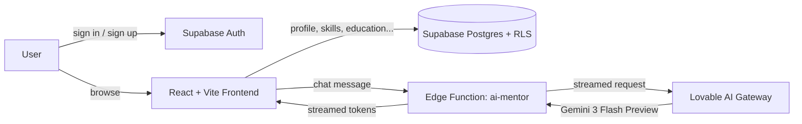

<p align="center">
  
</p>

<h1 align="center">Synapse</h1>
<p align="center"><strong>Your career deserves intelligence — not just a resume.</strong></p>

<p align="center">
  https://muneeb-pt.github.io/SYNAPSE-mindspark/ 
  Last deployed by @Muneeb-PT Muneeb-PT 3 minute
  
  
  
  
  
  
  
</p>

<p align="center">
  Built in ~12 hours at <strong>KAPRICIOUS'26</strong>, KMEA Engineering College, Cochin — our first hackathon, first year of college.
</p>

---

Synapse is an AI‑first career intelligence platform. Instead of reducing a person to a resume, it builds a **living profile** — skills, goals, strengths, personality — and pairs it with an AI mentor and a fairness‑driven matching layer so job seekers and recruiters connect on fit, not keywords.


## Table of Contents

- [Features](#features)
- [How It Works](#how-it-works)
- [Tech Stack](#tech-stack)
- [Project Status](#project-status)
- [Getting Started](#getting-started)
- [Project Structure](#project-structure)
- [Roadmap](#roadmap)
- [Team](#team)
- [License](#license)

## Features

| | Feature | Description |
|---|---|---|
| 🧠 | **AI Mentor Engine** | A conversational mentor that gives real‑time, personalized guidance instead of generic advice. |
| 🎯 | **Smart Matching** | Connects seekers with recruiters on best‑fit signals rather than keyword/skill matching alone. |
| 🗺️ | **Career Roadmaps** | Milestone‑based learning paths that adapt as a user's skills and goals evolve. |
| 👤 | **Deep Profiles** | Captures interests, work preferences, and goals — not just a static resume. |
| ⚡ | **Micro‑Interactions** | Lightweight polls and nudges that continuously refine a profile over time. |
| 🔒 | **Privacy First** | Row‑Level Security on every table — users only ever see their own data. |

## How It Works



The frontend is a Vite + React SPA. Auth, profile data, and the skills/education/experience/certifications tables live in Supabase Postgres behind Row‑Level Security policies. Chat messages from the **Mentor** page are sent to a Supabase Edge Function (`supabase/functions/ai-mentor`), which streams a completion from the Lovable AI Gateway (Gemini 3 Flash Preview) back to the client.

## Tech Stack

**Frontend** — React 18 · TypeScript · Vite · React Router · TanStack Query · React Hook Form + Zod · Tailwind CSS · shadcn/ui (Radix primitives) · Framer Motion · Recharts

**Backend** — Supabase (Postgres, Auth, Row‑Level Security, Edge Functions on Deno) · Lovable AI Gateway (Gemini 3 Flash Preview)

**Tooling** — ESLint · Vitest + Testing Library (unit) · Playwright (e2e) · scaffolded with [Lovable](https://lovable.dev)

## Project Status

Being upfront about this, since it was built in a 2‑hour hackathon sprint:

**Live and working:**
- Email/password auth via Supabase (`src/lib/auth-context.tsx`)
- Profile, skills, education, experience, and certifications persisted to Postgres with RLS
- AI Mentor chat, streamed live from Gemini 3 Flash via the `ai-mentor` edge function

**Prototype / demo data:**
- Dashboard, Roadmap, Profile extras, and the Recruiter candidate list currently render from `src/lib/mock-data.ts` rather than live queries
- The skill‑gap / "reality check" scoring in `use-career-intelligence.ts` is a hardcoded rule table, not model‑driven — a good candidate to move server‑side or connect to the AI mentor next

Calling this out here (rather than letting someone discover it later) is normal for a 2‑hour build — see [Roadmap](#roadmap) for what's next.

## Getting Started

### Prerequisites
- Node.js 18+
- A [Supabase](https://supabase.com) project (free tier is fine)
- The Supabase CLI, if you want to run the edge function locally: `npm i -g supabase`

### 1. Clone and install
```bash
git clone https://github.com/Muneeb-PT/SYNAPSE-mindspark.git
cd SYNAPSE-mindspark
npm install
```
> The repo currently has both `package-lock.json` and `bun.lock`/`bun.lockb`. Pick one package manager and remove the other lockfile — see the suggestions below.

### 2. Configure environment variables
Copy the example file and fill in your own Supabase project values (find these under Project Settings → API):
```bash
cp .env.example .env
```
| Variable | Description |
|---|---|
| `VITE_SUPABASE_URL` | Your Supabase project URL |
| `VITE_SUPABASE_PUBLISHABLE_KEY` | Supabase anon/public key (safe for client use — access is enforced by RLS) |
| `VITE_SUPABASE_PROJECT_ID` | Supabase project reference ID |

The AI mentor function needs one more secret, set on the **Supabase** side (not in `.env`), since it runs server‑side:
```bash
supabase secrets set LOVABLE_API_KEY=your_lovable_gateway_key
supabase functions deploy ai-mentor
```

### 3. Apply the database schema
```bash
supabase link --project-ref your-project-ref
supabase db push
```

### 4. Run it
```bash
npm run dev        # http://localhost:8080
npm run test        # unit tests (Vitest)
npm run test:watch  # watch mode
npx playwright test # end-to-end tests
npm run build        # production build
```

## Project Structure

```
src/
├─ pages/                  # Landing, Auth, Onboarding, Dashboard, Mentor, Roadmap, Chat, Profile, RecruiterDashboard
├─ components/
│  ├─ AppLayout.tsx        # Authenticated shell + nav
│  └─ ui/                  # shadcn/ui primitives
├─ hooks/                  # use-career-intelligence, use-profile, use-mobile, use-toast
├─ integrations/supabase/  # Supabase client + generated DB types
├─ lib/                    # auth-context, mock-data, utils
└─ test/                   # Vitest setup

supabase/
├─ functions/ai-mentor/    # Edge function — streams the AI mentor chat
└─ migrations/             # Postgres schema + RLS policies
```

## Roadmap

Ideas for turning the prototype into a fuller product:

- [ ] Replace `mock-data.ts` on Dashboard / Roadmap / Recruiter views with live Supabase queries
- [ ] Persist chat history from the Mentor page instead of keeping it client‑side only
- [ ] Turn the rule‑based matching/gap logic into a real scored matching pipeline
- [ ] Recruiter‑side actions: shortlist, message, and export candidates
- [ ] Deploy a live demo (Vercel/Netlify/Lovable) and link it at the top of this README

## Team

Built by first‑year students at KMEA Engineering College, Cochin, during **KAPRICIOUS'26**:

- Mohammed Muneeb PT
- Udhav Krishna M
- Anandakrishnan B
- Riyan K R

## License

Distributed under the MIT License. See [`LICENSE`](./LICENSE) for details.
