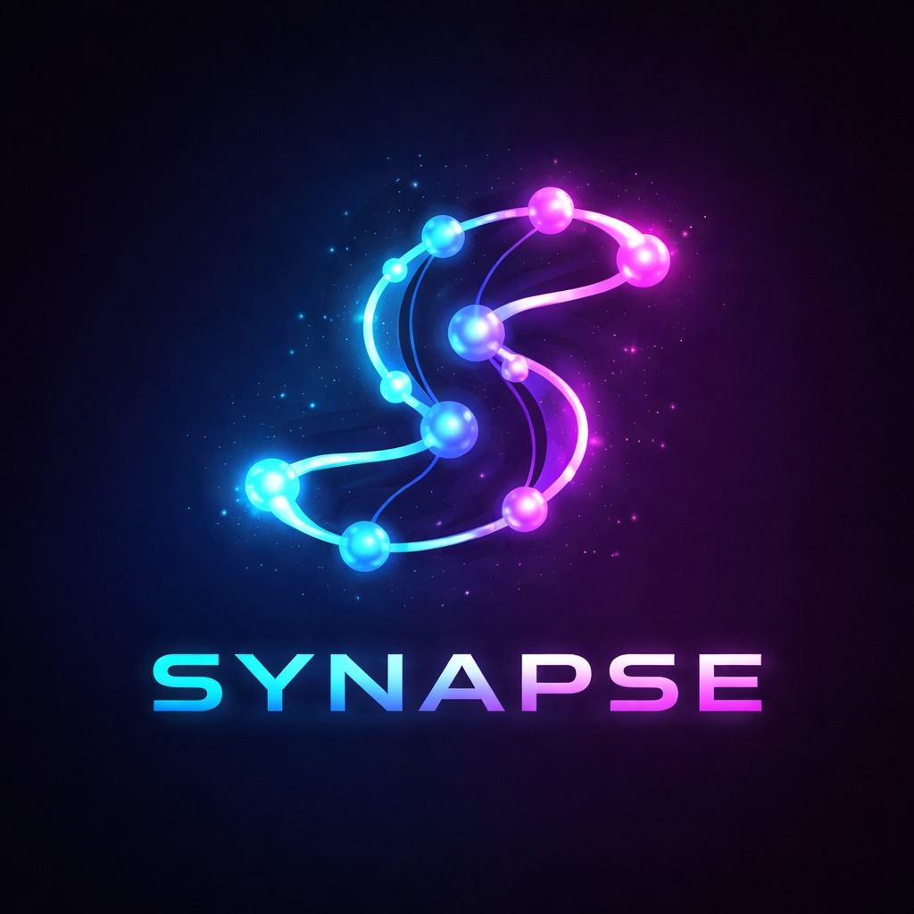
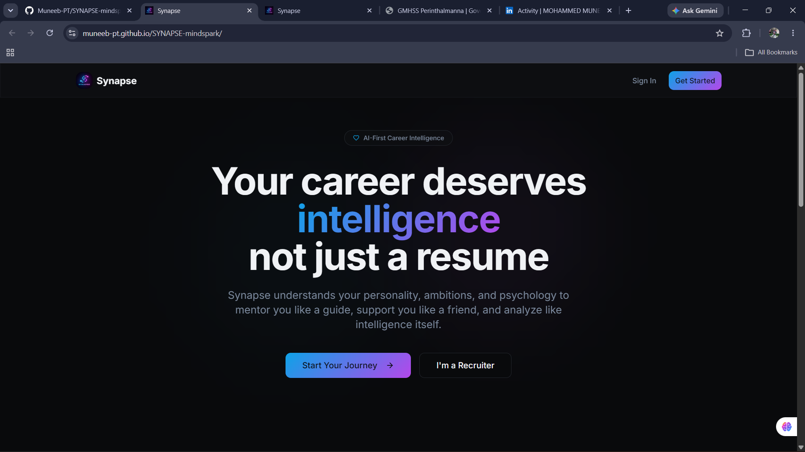
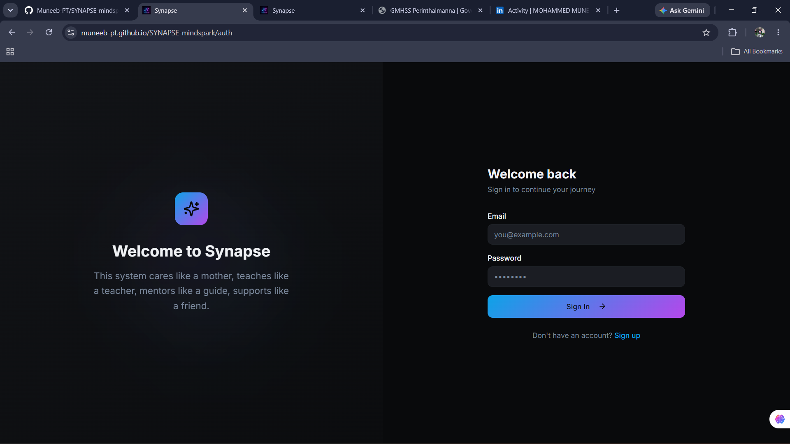
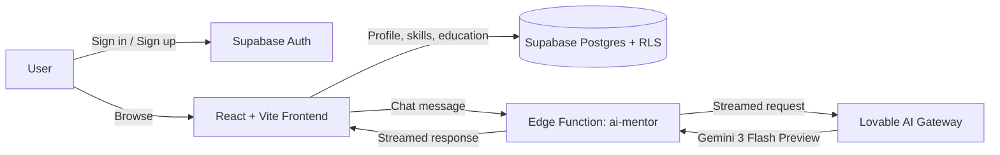

\<p align="center">   \ \</p>

\<h1 align="center">SYNAPSE\</h1>

\<p align="center">   \<strong>Your career deserves intelligence — not just a resume.\</strong> \</p>

\<p align="center">   \<a href="[https://muneeb-pt.github.io/SYNAPSE-mindspark/](https://muneeb-pt.github.io/SYNAPSE-mindspark/)">     \<strong>🚀 View Live Demo\</strong>   \</a> \</p>

\<p align="center">   \   \   \   \   \   \   \ \</p>

\<p align="center">   Built in \<strong>2 hours\</strong> at \<strong>KAPRICIOUS'26\</strong>,   KMEA Engineering College, Cochin — our first hackathon as first-year students. \</p>

---

## 💡 About SYNAPSE

SYNAPSE is an AI-assisted career intelligence platform designed to bridge the gap between job seekers and recruiters.

Many students have potential but lack the skills, experience, or career guidance needed to become employable. At the same time, recruiters face challenges identifying suitable candidates through traditional resumes and keyword-based filtering.

SYNAPSE explores a different approach.

Instead of reducing a person to a resume, it builds a **living profile** around their skills, goals, strengths, interests, and personality. An AI mentor provides personalized career guidance, while a smarter matching concept aims to connect job seekers and recruiters based on potential and suitability — not just keywords.

## 📸 Screenshots

\<p align="center">
&#x20; \<strong>Dashboard\</strong>\<br/>
&#x20; \
\</p>

\<p align="center">
&#x20; \<strong>Home\</strong>\<br/>
&#x20; \
\</p>

\<p align="center">
&#x20; \<strong>Login\</strong>\<br/>
&#x20; \
\</p>

---

## ✨ Features

|     | Feature                | Description                                                                          |
| --- | ---------------------- | ------------------------------------------------------------------------------------ |
| 🧠  | **AI Mentor Engine**   | A conversational mentor that provides personalized career guidance.                  |
| 🎯  | **Smart Matching**     | Aims to connect job seekers and recruiters through suitability-based matching.       |
| 🗺️ | **Career Roadmaps**    | Milestone-based learning paths that help users work toward career goals.             |
| 👤  | **Deep Profiles**      | Captures interests, work preferences, skills, and goals beyond a traditional resume. |
| ⚡   | **Micro-Interactions** | Lightweight polls and prompts designed to refine user profiles over time.            |
| 🔒  | **Privacy First**      | Uses Supabase Row-Level Security to restrict access to user data.                    |

## ⚙️ How It Works



The frontend is a Vite + React single-page application.

Authentication, profile data, and skills, education, experience, and certifications are stored in Supabase Postgres with Row-Level Security policies.

Messages from the Mentor page are sent to a Supabase Edge Function (`supabase/functions/ai-mentor`), which requests a response from the Lovable AI Gateway using Gemini 3 Flash Preview and streams the response back to the frontend.

## 🛠️ Tech Stack

**Frontend** — React 18 · TypeScript · Vite · React Router · TanStack Query · React Hook Form · Zod · Tailwind CSS · shadcn/ui · Framer Motion · Recharts

**Backend** — Supabase · PostgreSQL · Supabase Auth · Row-Level Security · Edge Functions (Deno)

**AI Integration** — Lovable AI Gateway · Gemini 3 Flash Preview

**Testing & Tooling** — ESLint · Vitest · Testing Library · Playwright

**Development Platform** — [Lovable](https://lovable.dev)

## 🚧 Project Status

SYNAPSE was developed as a **2-hour hackathon prototype**. The following distinction is important when evaluating its current implementation.

### Live and Working

- Email/password authentication through Supabase.
- User profile, skills, education, experience, and certifications persisted in PostgreSQL.
- Row-Level Security policies for user data.
- AI Mentor chat with streamed responses from Gemini 3 Flash through the `ai-mentor` Edge Function.

### Prototype / Demo Implementation

- Dashboard, Roadmap, additional Profile sections, and Recruiter candidate listings currently use mock data from `src/lib/mock-data.ts`.
- Skill-gap and career-readiness calculations in `use-career-intelligence.ts` use predefined rules rather than an AI-driven evaluation.
- Some matching and recruiter features represent the product concept and require further development.

These limitations reflect the prototype's development scope and provide clear opportunities for future improvements.

## 🚀 Getting Started

### Prerequisites

- Node.js 18+
- A [Supabase](https://supabase.com) project
- Supabase CLI (optional, for local Edge Function development)

### 1. Clone the Repository

```bash
git clone https://github.com/Muneeb-PT/SYNAPSE-mindspark.git
cd SYNAPSE-mindspark
npm install
```

### 2. Configure Environment Variables

Copy the example environment file:

```bash
cp .env.example .env
```

Configure the following variables using your Supabase project details:

| Variable                        | Description                   |
| ------------------------------- | ----------------------------- |
| `VITE_SUPABASE_URL`             | Supabase project URL          |
| `VITE_SUPABASE_PUBLISHABLE_KEY` | Supabase public/anon key      |
| `VITE_SUPABASE_PROJECT_ID`      | Supabase project reference ID |

### 3. Configure the AI Mentor

Set the required secret on the Supabase side:

```bash
supabase secrets set LOVABLE_API_KEY=your_lovable_gateway_key
supabase functions deploy ai-mentor
```

### 4. Apply the Database Schema

```bash
supabase link --project-ref your-project-ref
supabase db push
```

### 5. Run the Application

```bash
npm run dev
```

The development server runs at:

```text
http://localhost:8080
```

Additional commands:

```bash
npm run test         # Run unit tests
npm run test:watch   # Run tests in watch mode
npx playwright test  # Run end-to-end tests
npm run build        # Build for production
```

## 📁 Project Structure

```text
src/
├── pages/                  # Landing, Auth, Dashboard, Mentor, Roadmap, etc.
├── components/
│   ├── AppLayout.tsx       # Authenticated application layout
│   └── ui/                 # Reusable UI components
├── hooks/                  # Career intelligence and profile hooks
├── integrations/
│   └── supabase/           # Supabase client and database types
├── lib/                    # Authentication, mock data, utilities
└── test/                   # Vitest setup

supabase/
├── functions/
│   └── ai-mentor/          # AI Mentor Edge Function
└── migrations/             # Database schema and RLS policies

assets/
├── dashboord.png
├── home.png
└── login.png
```

## 🗺️ Roadmap

- [ ] Replace mock data on Dashboard, Roadmap, and Recruiter views with live Supabase queries.
- [ ] Persist AI Mentor chat history.
- [ ] Develop a more comprehensive skill-gap and career-readiness evaluation system.
- [ ] Build a scored candidate-matching pipeline.
- [ ] Add recruiter actions such as shortlisting, messaging, and candidate exports.
- [ ] Improve and deploy a more complete live demonstration.

## 👥 Team

Developed by a team of first-year students at **KMEA Engineering College, Cochin**, during **KAPRICIOUS'26**.

- **Mohammed Muneeb PT**
- **Udhav Krishna M**
- **Anandakrishnan B**
- **Riyan K R**

Our first hackathon. Two hours. One team. One working prototype.

## 📄 License

Distributed under the MIT License. See [`LICENSE`](./LICENSE) for details.
